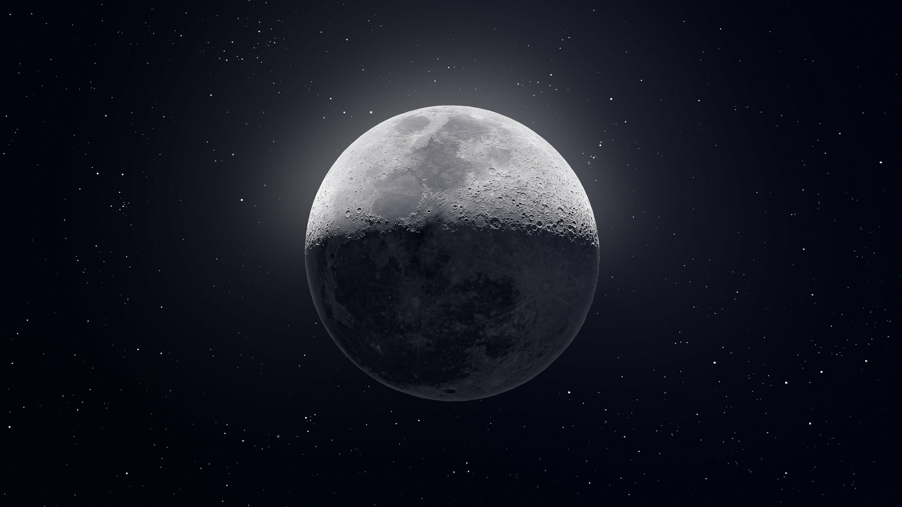
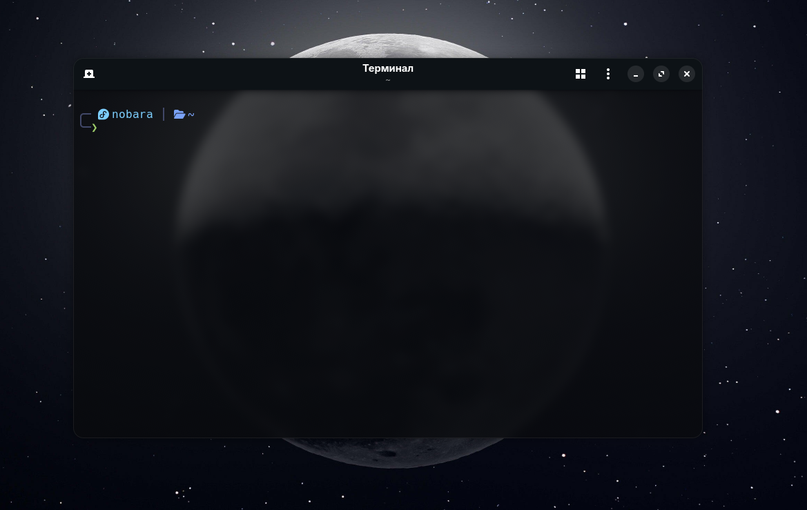
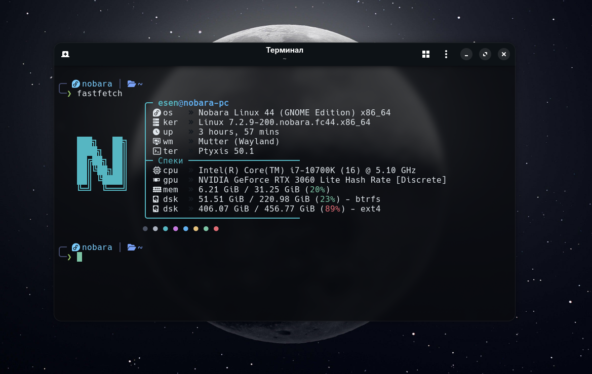
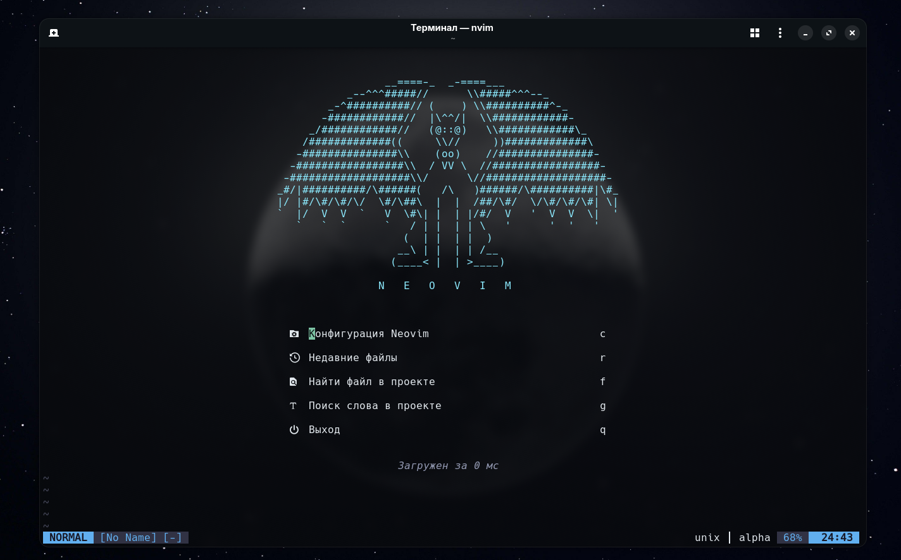
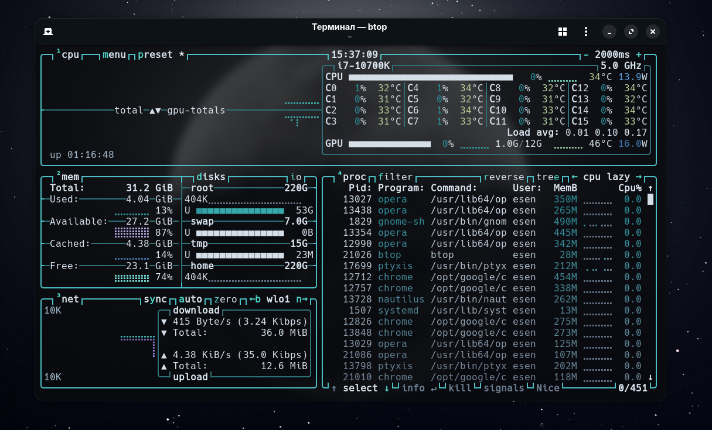

<div align="center">

# 🌙 Minimalist Moon Dotfiles

<p align="center">
  <b>Nobara Linux • GNOME • Ptyxis • Pure Bash • Modular Neovim</b>
</p>

[🇷🇺 Читать на русском](README.ru.md)

---

### 📸 Screenshots


<br><br>


<br><br>

<br><br>


</div>

---

## 💻 System Specifications
- **OS:** Nobara Linux 44 (GNOME Edition)
- **Compositor:** Mutter (Wayland)
- **Terminal:** Ptyxis
- **Shell:** Bash (custom prompt in pure Bash, no Starship required)
- **Editor:** Neovim (built from scratch using `lazy.nvim` with modular architecture)
- **CLI Tools:** `fastfetch`, `eza`, `btop`
- **Color Palette:** Tokyo Night / Moon Monochrome

## 📂 Repository Structure
* **`.bashrc`** — Fast, pure Bash 24-bit TrueColor prompt:
  * Exit code indicator (`× 127`, `× 1`, etc.)
  * Git branch status and dirty flag (`*`)
  * Auto-detection of package managers (`pnpm`, `npm`, `yarn`)
  * Modern aliases with `eza` icons
* **`.config/nvim/`** — Modular Neovim configuration:
  * Package manager: `lazy.nvim`
  * UI: Custom `alpha-nvim` dashboard, `neo-tree`, `lualine`, `noice.nvim`
  * Development: LSP (`mason`), `treesitter` highlighting, auto-completion, formatting
* **`.config/fastfetch/`** — Customized hardware info block with rounded borders and minimalist specs.
* **`.config/btop/`** — System monitor config with a theme matching the rest of the setup.

## 🚀 Quick Start
```bash
git clone https://github.com/Kapat1ch/dotfiles.git ~/dotfiles
```
