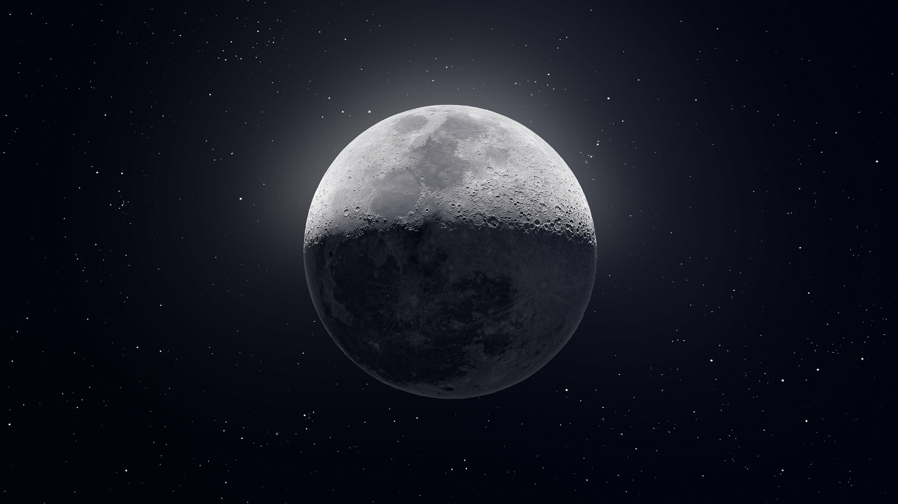
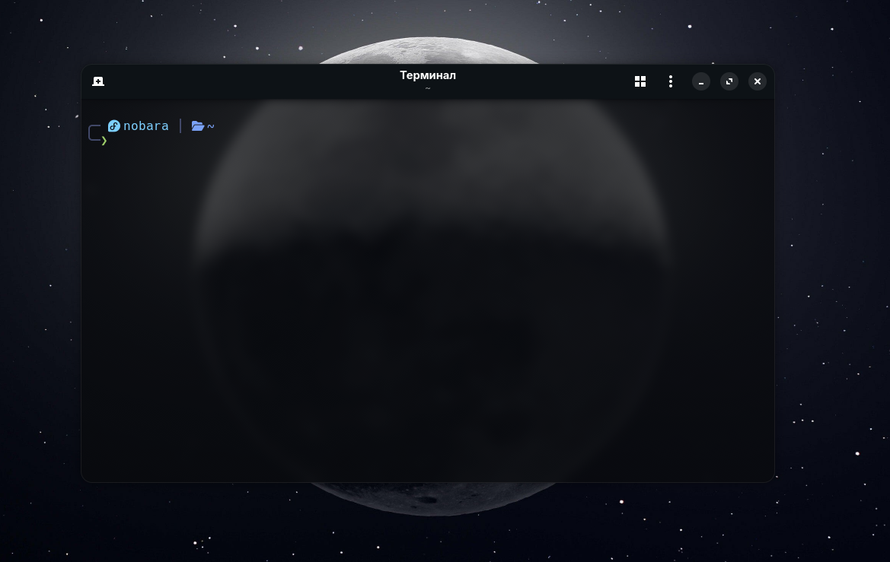
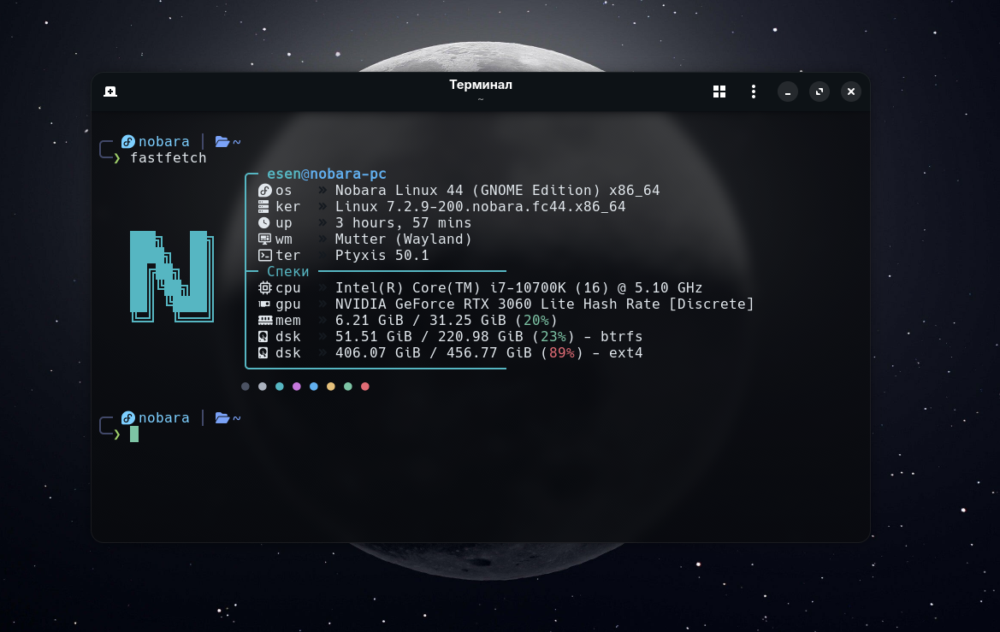
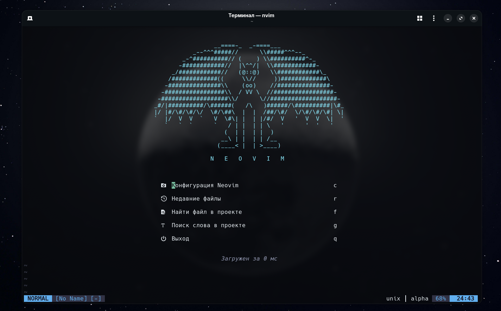
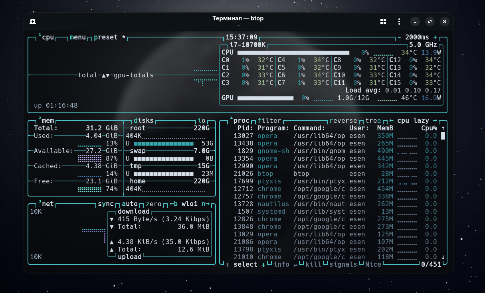

<div align="center">

# 🌙 Minimalist Moon Dotfiles

<p align="center">
  <b>Nobara Linux • GNOME • Ptyxis • Чистый Bash • Модульный Neovim</b>
</p>

[🇬🇧 Read in English](README.md)

---

### 📸 Скриншоты


<br><br>


<br><br>

<br><br>


</div>

---

## 💻 Спеки и окружение
- **ОС:** Nobara Linux 44 (GNOME Edition)
- **Композитор:** Mutter (Wayland)
- **Терминал:** Ptyxis
- **Оболочка:** Bash (кастомный двустрочный промпт на чистом Bash)
- **Редактор:** Neovim (модульная сборка с нуля на базе `lazy.nvim`)
- **Утилиты:** `fastfetch`, `eza`, `btop`
- **Цветовая палитра:** Tokyo Night / Moon Monochrome

## 📂 Что внутри
* **`.bashrc`** — Легковесный промпт на чистом Bash с TrueColor цветами:
  * Наглядный код ошибки при падении команды (`× 127`, `× 1` и т.д.)
  * Статус Git (ветка и маркер изменений `*`)
  * Автоопределение пакетного менеджера проекта (`pnpm`, `npm`, `yarn`)
  * Удобные алиасы с иконками через `eza`
* **`.config/nvim/`** — Чистая модульная архитектура Neovim:
  * Менеджер плагинов: `lazy.nvim`
  * Интерфейс: кастомный арт в `alpha-nvim`, файловый менеджер `neo-tree`, `lualine`, `noice.nvim`
  * Разработка: LSP (`mason`), подсветка `treesitter`, автодополнение кода, форматирование
* **`.config/fastfetch/`** — Кастомный блок с характеристиками ПК и скругленными рамками.
* **`.config/btop/`** — Конфиг системного монитора с темой в цветах остальной сборки.

## 🚀 Установка
```bash
git clone https://github.com/Kapat1ch/dotfiles.git ~/dotfiles
```
